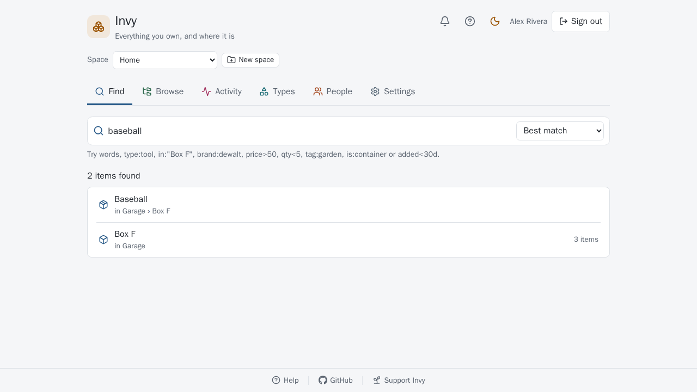
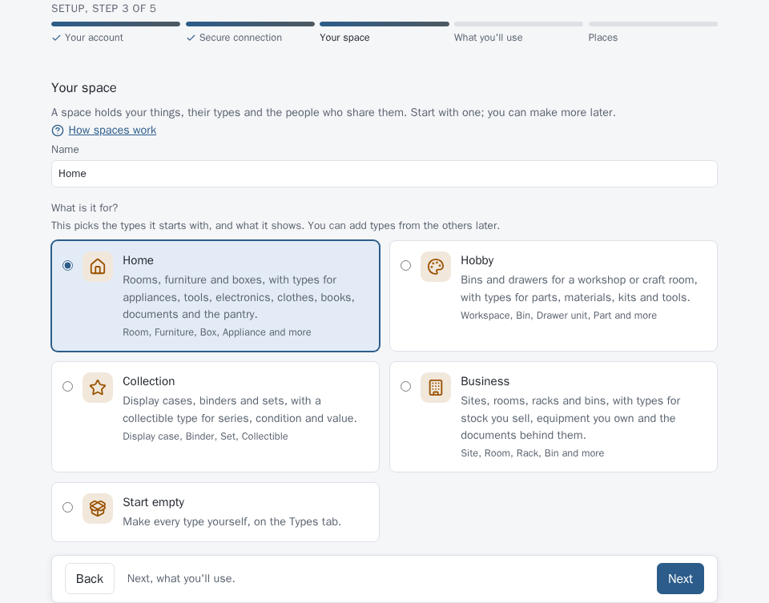
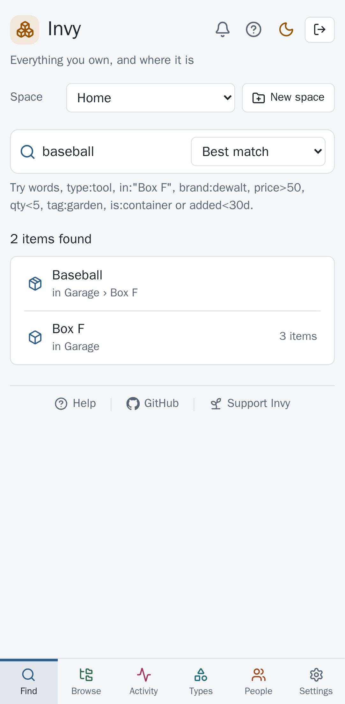
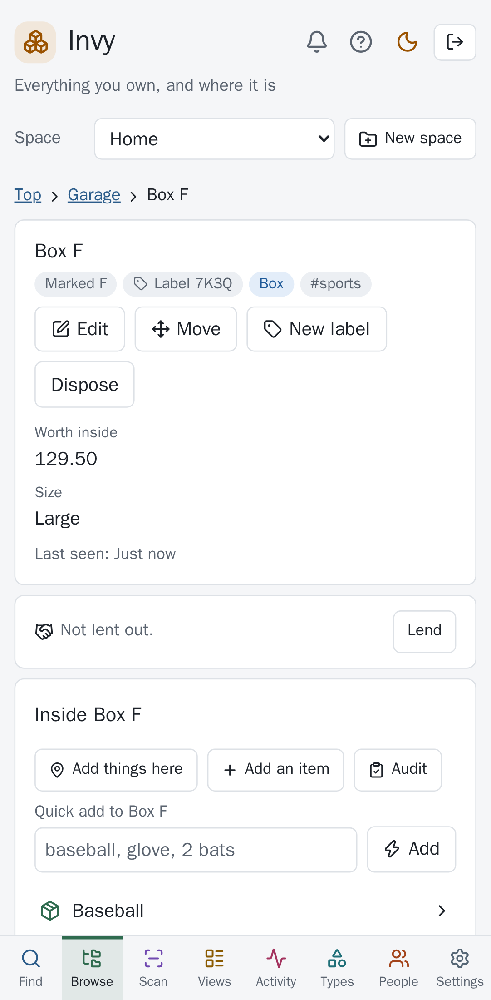
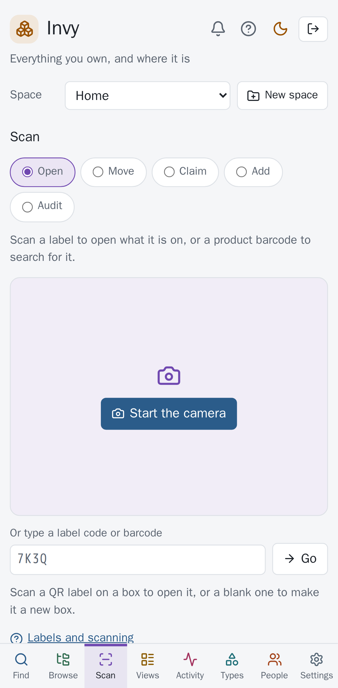
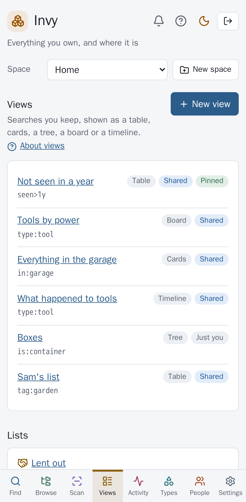

<div align="center">

# Invy

**The self-hosted home inventory that knows what you own, where you put it, and finds it in a moment.**

Label your boxes, scan them with your phone, and search everything you own as you type.
For homes, workshops, collections and small businesses. Runs on your own server with Docker or Podman, or on
Windows. Free and open source.

[](LICENSE)
[](https://github.com/FreeReins/invy/releases)
[](https://github.com/FreeReins/invy/pkgs/container/invy)
[](https://freereins.github.io/Invy/)
[](https://buymeacoffee.com/strifer.btw)

[**Get started**](#get-started-in-two-minutes) · [**Features**](#features) · [**Documentation**](docs/index.md) · [**Screenshots**](#screenshots)

<picture>
  <source media="(prefers-color-scheme: dark)" srcset="docs/images/find-desktop-dark.png">
  
</picture>

</div>

## Label it. Scan it. Find it.

- **Label it:** print QR labels on ordinary Avery sticker sheets and stick them on boxes, bins and shelves.
- **Scan it:** point any phone camera at a label to open the box, see what's inside, or move it somewhere new.
- **Find it:** type a few letters and Invy says where it is: *Garage › Box F › Baseball*.

## Why Invy

**Never dig through boxes again.** Every item knows its place, every place knows what's in it, and search finds
anything in your house as you type, even when you misspell it.

**Boxes inside boxes, as deep as you like.** Shed › Shelf 2 › Box ABC › Box F. Move a box and everything in it moves
too, and each thing keeps a timeline of where it has been and who moved it.

**Less typing than a spreadsheet.** Add `baseball, glove, 2 bats` in one line, scan a product's barcode, or take a
photo of an open box and let an AI model list what's in it for you to check.

**Ask your assistant.** Invy has a built-in MCP server, so Claude and other AI assistants can answer *"Where's the
drill?"* and do *"Put the glove in box F"* for you.

**Your things, your server.** No account to make, no subscription, no ads, no tracking. The list of everything you
own stays on your own hardware.

## Made for



- 🏠 **Home:** the drill in the shed, the spare HDMI cables, the dishwasher's warranty, the holiday decorations in
  the loft. Know what's in every box before you open it.
- 🛠️ **Hobby and workshop:** parts, filament and kits in bins and drawers. Get told before the screws run low, and
  set parts aside for a project.
- ⭐ **Collections:** cards, coins, Lego and vinyl, with series, condition and value, and a record of who borrowed what.
- 🏢 **Small business:** stock, equipment and documents across sites, racks and bins, with audits, asset tags and
  an insurance inventory ready to print.
- 🚚 **Moving house:** give each box a destination, print a manifest to tape on it, and tick it off as it arrives.

Pick a kind when you set up a space and Invy starts with the right types, features and places. Mix and match
any time.

<br clear="right">

## Features

| | |
|---|---|
| 🔎 **Instant search** | Results as you type, near spellings included. Narrow it down with `type:tool`, `in:shed`, `brand:dewalt`, `price>50` or `seen>1y`. [Search →](docs/using/search.md) |
| 📦 **Boxes in boxes** | Rooms, shelves, boxes and things nest to any depth. Moves keep a full timeline. [Items →](docs/using/items.md) · [Timeline →](docs/using/timeline.md) |
| 🏷️ **QR labels and scanning** | Print Avery 5160 or L7651 sheets. Scan to open, move, claim a blank label as a new box, add, or audit. [Labels →](docs/using/labels-and-scanning.md) |
| 📷 **Barcodes, photos and files** | Scan a product's barcode to fill in its name and brand (once you switch lookups on), and keep photos, receipts and manuals with each thing. [Items →](docs/using/items.md) |
| 🧩 **Your own types and fields** | Twelve kinds of field, from money and dates to choices, barcodes and links to other items. Starter packs for every kind of space. [Types →](docs/using/types-and-fields.md) |
| 📊 **Views and reports** | Save any search as a table, cards, tree, board or timeline, and pin it to the front page. See what it's all worth, print an insurance inventory, or export to CSV. [Views →](docs/using/views.md) · [Reports →](docs/using/reports.md) |
| ✅ **Audits** | Walk a box, tick what's there, and Invy lists what's missing and what turned up elsewhere. [Audits →](docs/using/audits.md) |
| 📉 **Low stock** | Set a level on counted things and get a notification before you run out. [Stock →](docs/using/stock.md) |
| 🤝 **Lending** | Note who borrowed it and when it's due back, and see what's overdue. [Lending →](docs/using/lending.md) |
| ⏰ **Reminders and upkeep** | Warranty ends, services due and expiry dates, in Invy and in your calendar app. [Reminders →](docs/using/reminders.md) |
| 🛠️ **Projects** | Set parts aside for a build so they aren't counted as free, then use them up. [Projects →](docs/using/projects.md) |
| 📥 **Bring your list** | Import any spreadsheet as CSV, or a Homebox export with its locations, labels and details. [Imports →](docs/using/imports.md) |
| 🤖 **AI that helps, never guesses for you** | List what's in a photo of a box, read a nameplate's model and serial, suggest fields and types. Every answer is a suggestion you confirm. Claude, OpenAI, Ollama or any OpenAI-compatible model. [AI assistants →](docs/admin/ai-assistants.md) |
| 🧠 **MCP server built in** | Claude, Claude Code and other assistants can find, add, move, lend and count things, with per-person tokens that can be read-only. [AI assistants →](docs/admin/ai-assistants.md#connect-an-assistant-to-invy) |
| 👪 **Spaces and people** | Home, Workshop, Shop: each space has its own things and members, as owners, editors or viewers. Changes show up live for everyone. [Spaces →](docs/using/spaces.md) |
| 🔔 **Notifications** | Low stock, loans and reminders sent to Home Assistant or any webhook. [Notifications →](docs/admin/notifications.md) |
| 💾 **Backs itself up** | Nightly backups, photos included, with one-click restore. [Backups →](docs/admin/backups-and-restore.md) |
| 🔒 **Secure by default** | HTTPS out of the box, account lockout, and a strict browser security policy. [HTTPS →](docs/admin/https-and-certificates.md) |

## Works with

**Home Assistant** (notifications) · **Node-RED, n8n, Gotify, Discord, Slack** (any JSON webhook) ·
**Google Calendar, Apple Calendar, Outlook** (reminder feed) · **Claude, Claude Code and other MCP assistants** ·
**Claude, OpenAI, Ollama, LM Studio, OpenRouter** (AI models) · **Homebox** (CSV import) · **Avery** label sheets ·
**Open Food Facts, UPCitemdb** (barcode lookup) · **Tailscale, Caddy, Traefik, nginx** ·
**Docker, Podman, Windows, Synology, Unraid, TrueNAS, Portainer, Raspberry Pi**

## Get started in two minutes

Invy is one container (or one Windows program) with its database inside. Nothing else to set up.

**Docker or Podman** (Linux, macOS, NAS):

```sh
docker run -d --name invy --restart unless-stopped -p 8080:8080 -p 8443:8443 \
  -v invy-data:/data -e TZ=America/Chicago ghcr.io/freereins/invy:latest
```

**Podman as a service** (Fedora, Bazzite and other Linux with systemd; starts at boot and updates itself):

```sh
curl -fsSL https://raw.githubusercontent.com/freereins/invy/main/deploy/podman/install.sh | bash
```

**Windows:** download `Invy-….msi` from the [latest release](https://github.com/FreeReins/invy/releases/latest)
and run it, or the portable `Invy-…-portable.exe` to try it without installing.

Then open `http://<your server>:8080` and follow the setup wizard: make your account, pick what your space is for,
tick the rooms you have, and start adding things.
[Full install guides →](docs/getting-started/requirements.md)

## Documentation

Everything you need to run Invy is in [the documentation](docs/index.md). It's plain Markdown that you can read
here, on the [documentation site](https://freereins.github.io/Invy/), or inside Invy itself by pressing **?**.

| I want to… | Start here |
|---|---|
| Install Invy | [Requirements](docs/getting-started/requirements.md) · [Podman](docs/getting-started/install-podman.md) · [Docker](docs/getting-started/install-docker-compose.md) · [Windows](docs/getting-started/install-windows.md) · [NAS and others](docs/getting-started/install-other-platforms.md) |
| Learn to use it | [First run](docs/getting-started/first-run.md) · [Items and boxes](docs/using/items.md) · [Labels and scanning](docs/using/labels-and-scanning.md) · [Search](docs/using/search.md) |
| Run it for my household or team | [People](docs/admin/people-and-accounts.md) · [Settings](docs/admin/settings.md) · [HTTPS](docs/admin/https-and-certificates.md) · [Backups](docs/admin/backups-and-restore.md) · [Upgrading](docs/admin/upgrading.md) |
| Fix a problem | [Troubleshooting](docs/troubleshooting/index.md) |
| Automate it | [HTTP API](docs/reference/api.md) · [MCP for AI assistants](docs/admin/ai-assistants.md) · [Notifications](docs/admin/notifications.md) |
| Build on it | [The design](docs/developers/design.md) · [Data model](docs/developers/data-model.md) · [Contributing](CONTRIBUTING.md) |

## Screenshots

| Find | Browse | Scan | Views and reports |
|---|---|---|---|
|  |  |  |  |

## Your data stays yours

Invy has no cloud service, no telemetry and no accounts outside your server. It only goes out to the internet for
what you switch on: barcode lookups (off until an admin turns them on), and the webhook and AI models you set up.

## Support and contributing

- **Questions or problems?** Start with [Troubleshooting](docs/troubleshooting/index.md), then
  [open an issue](https://github.com/FreeReins/invy/issues/new/choose). See [SUPPORT.md](SUPPORT.md).
- **Security issue?** Report it privately, as [SECURITY.md](SECURITY.md) describes.
- **Want to help?** Read [CONTRIBUTING.md](CONTRIBUTING.md) and [the design](docs/developers/design.md). Starter
  packs of types for more kinds of collections and hobbies are especially welcome.
- **Enjoying Invy?** Star the repository, tell a friend, or [buy me a coffee](https://buymeacoffee.com/strifer.btw).

## License

[GNU General Public License v3.0](LICENSE).
