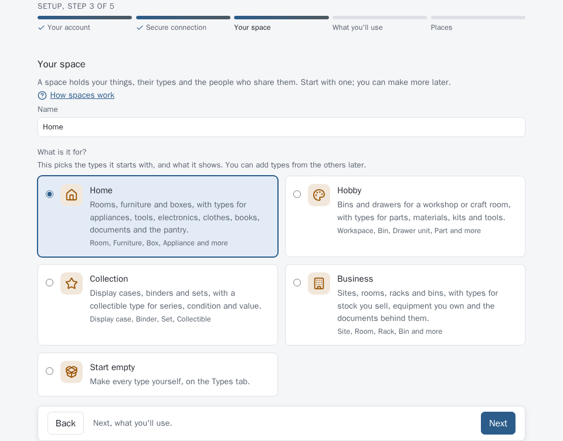
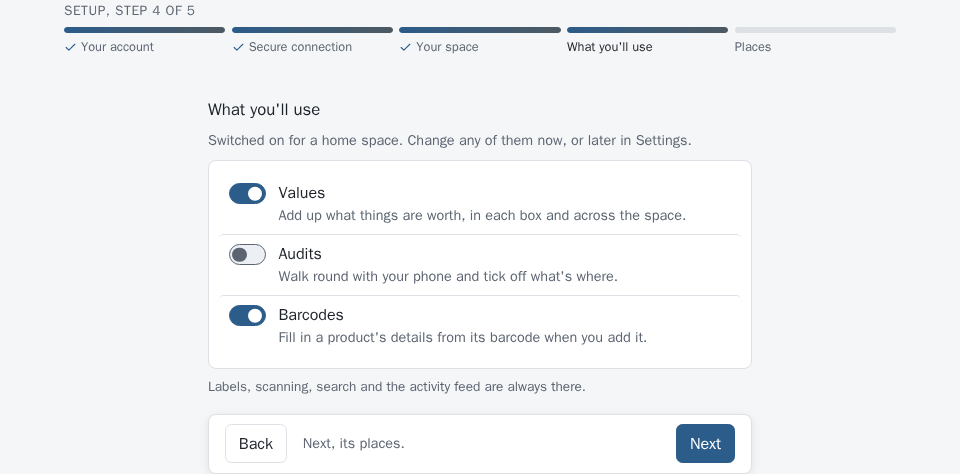
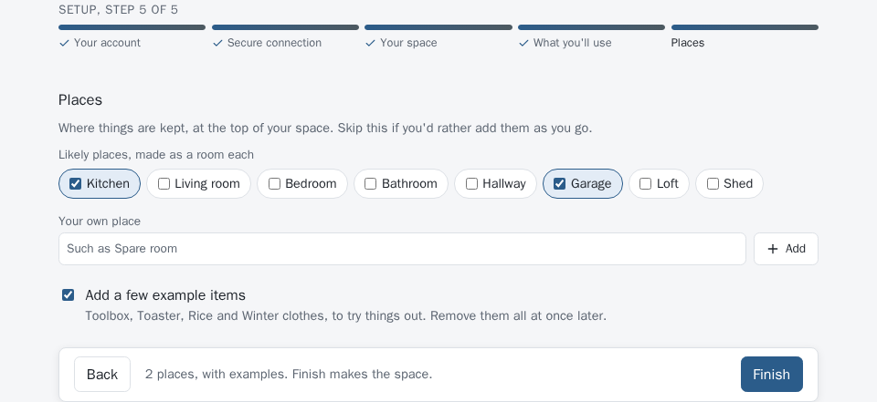

# First run

The first time you open Invy, a short setup wizard creates your account, checks the secure connection and sets up
your first space. It takes a few minutes, and you can change everything later under **Settings**.

## The setup wizard

1. **Create your account.** Enter your name, a username and a password of at least 8 characters. This first
   account is the **admin**: it runs the server (HTTPS, backups, AI models and logs) and can invite other people.
2. **Secure connection.** This step is left out when HTTPS is turned off, for example behind a reverse proxy. It
   shows the HTTPS address and lets you:
   - enter the names and addresses people use to reach Invy, such as `invy.local` or `192.168.1.20`, so the
     certificate matches them;
   - download the certificate, to install on your devices so the browser stops warning;
   - choose **Always use HTTPS**, which is on to start with.

   [HTTPS and certificates](../admin/https-and-certificates.md) explains each of these.
3. **Your space.** Give your first space a **Name** and pick what it's for: **Home**, **Hobby**, **Collection**,
   **Business**, or **Start empty**. The kind picks the types it starts with, the features switched on in the next
   step, the places suggested after that, and the hints on empty screens. [Spaces](../using/spaces.md#kinds-of-space)
   says what each kind starts with.

   
4. **What you'll use.** The kind's features are already switched on, one line each. Switch any of them on or off;
   you can change them later in **Settings → Kind and features**.

   
5. **Places.** Tick the places you have, such as *Kitchen* and *Garage*, or add your own under **Your own place**.
   Tick **Add a few example items** to try Invy out with a handful of made-up things you can remove in one go later.
   Everything here is optional: finishing with nothing ticked makes an empty space.

   
6. Press **Finish**. Invy makes the space and opens it on the **Find** tab, with a **Getting started** card.

**Back** and the step names in the bar at the top move between the steps without losing your answers. The space is
only made when you press **Finish**.

## Next steps

- Follow the **Getting started** card on **Find**: its steps tick themselves as you go

- [Check your backups](../admin/backups-and-restore.md): Invy makes one every night
- [Set up an AI model or connect an assistant](../admin/ai-assistants.md)
- [Send notifications to Home Assistant](../admin/notifications.md)
