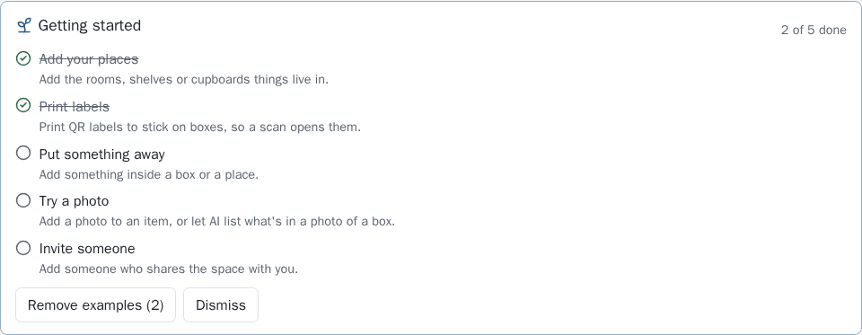
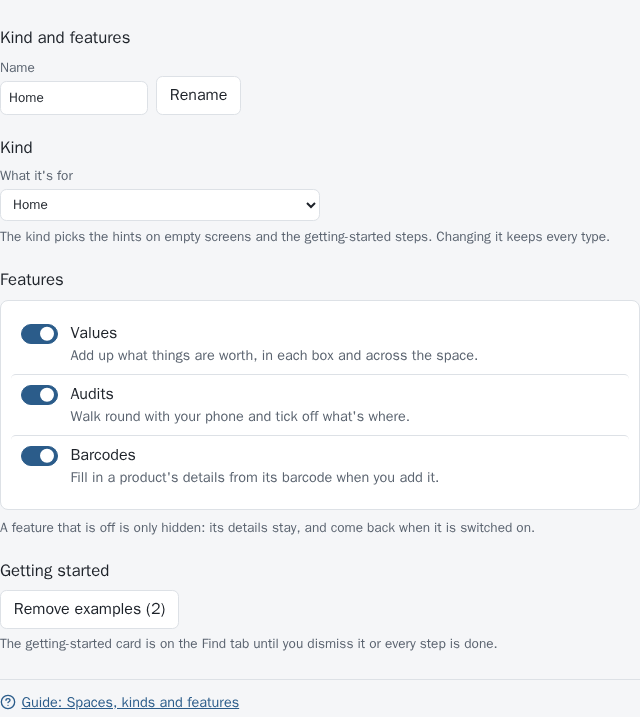

# Spaces, people and roles

This page is for anyone using Invy. It explains spaces, how to make one, and how to share it with the people you live
or work with.

A **space** holds its own items, types and people, such as *Home*, *Workshop* or *Shop*. You can be in several
spaces, and you pick the one you're looking at from the **Space** list under the header.

## Make a space

1. Press **New space** under the header. If you aren't in a space yet, every tab that needs one shows the same button.
2. **Your space:** give it a **Name**, and pick what it's for under **What is it for?** (see
   [Kinds of space](#kinds-of-space)), or **Start empty** to make every type yourself. Press **Next**.
3. **What you'll use:** the kind's [features](#features) are already switched on. Change any of them, then press
   **Next**.
4. **Places:** tick the places you have and add your own under **Your own place**. Tick **Add a few example items** to
   try things out. All of this is optional.
5. Press **Make the space**. You are its owner.

**Back** keeps your answers. The first-run setup asks the same three questions for your first space.

## Kinds of space

| Kind | Starts with these types | Features on | Places suggested |
|---|---|---|---|
| **Home** | Room, Furniture, Box, Appliance, Tool, Electronics, Clothing, Book, Document, Pantry item | Values, Barcodes, Lending, Reminders | Kitchen, Living room, Bedroom, Bathroom, Hallway, Garage, Loft, Shed |
| **Hobby** | Workspace, Bin, Drawer unit, Part, Material, Kit, Tool | Barcodes, Stock, Reminders, Projects | Workbench, Craft table, Desk, Garage, Shed, Spare room |
| **Collection** | Display case, Binder, Set, Collectible | Values, Lending | Living room cabinet, Study shelves, Glass case, Storage boxes |
| **Business** | Site, Room, Rack, Bin, Product, Equipment, Document | Values, Audits, Barcodes, Stock, Lending, Reminders | Shop, Warehouse, Office, Workshop, Stockroom |

A kind only adds types. You can change or remove any of them on the **Types** tab, and copy a type from another kind
with **Add from another pack** (see [Types and fields](types-and-fields.md#add-a-type-from-another-pack)). The kind also
picks the steps on the getting-started card and the hints on empty tabs. Places are made at the top of the space, as
the kind's place type (a *Room* in a home).

## Features

Each space switches features on and off by itself, so a home can use audits and a shop can use values.

| Feature | What it shows |
|---|---|
| **Values** | What things are worth: **Worth** on a counted thing, **Worth inside** on a box or place, the **Value** column in views, and the value totals and insurance inventory in [Reports](reports.md) |
| **Audits** | **Audit** on a box or place, Scan's **Audit** mode, and the missing items in [Reports](reports.md) |
| **Barcodes** | Looking up a product's barcode in Scan's **Add** mode (the admin's **Look up product barcodes online** switch still applies) |
| **Stock** | **Low stock at** on counted things, **Running low** on Views, and alerts when something runs low. See [Low stock](stock.md) |
| **Lending** | **Lend** and **It's back** on a thing, **Lent out** on Views, and overdue reminders. See [Lending](lending.md) |
| **Reminders** | **Remind, days ahead** on date fields, **Done today** for upkeep, **Coming up** on Views, and the calendar feed. See [Reminders and upkeep](reminders.md) |
| **Moving** | **Say where it's going**, **Manifest** and **Arrived** on a box, and **Moving** on Views. See [Moving house](moving.md) |
| **Projects** | **Set aside for a project** on a thing, and **Projects** on Views. See [Projects](projects.md) |

A feature that is off is only hidden: its details stay, and show again when it is switched back on. Labels, scanning,
search, Browse, Views, Types, Activity and [importing](imports.md) are always there. A feature that is off sends no
alerts or reminders for the space, and its calls in the [HTTP API](../reference/api.md) and for AI assistants still
work.

## Getting started and examples

A new space shows a **Getting started** card on **Find** with a few steps for its kind, such as *Add your places* and
*Print labels*. Each step ticks itself when the space shows it was done.

 The card goes away when every step is done,
or when you press **Dismiss**; it is yours alone, so dismissing it doesn't hide it for anyone else.

**Remove examples** on the card deletes the example items that are left, with their timelines. An example you've
changed is yours now and stays, and so does an example place that holds something of your own.

## Change a space's kind and features

Open **Settings → Kind and features**. Everyone in the space can look; only owners change things.

- **Name:** type a new one and press **Rename**.
- **What it's for:** pick another kind. This changes the hints and getting-started steps, never the types.
- **Features:** switch each one on or off.
- **Remove examples** (editors and owners) and **Show getting started again**, if you dismissed the card.

## Roles

| Role | Can |
|---|---|
| **Owner** | everything, including people and deleting the space |
| **Editor** | add, change, move and remove items and types |
| **Viewer** | search and look |

A space always keeps at least one owner. Being the admin who runs Invy gives you no access to a space: an admin
sees only the spaces they make or are added to.

## Add someone to a space

The person needs an account on this Invy first. If they don't have one, ask the admin for an invite link (see
[People and accounts](../admin/people-and-accounts.md)).

1. Open the **People** tab. Only owners see **Add someone**.
2. Type their **Username**, pick a **Role** and press **Add**.

To change someone's role, pick another one in the list beside their name. To take them out of the space, press
**Remove**. Nothing in the space changes when someone leaves it.

## Leave, rename or delete a space

- **Leave:** on the **People** tab, press **Leave** beside your own name. If you're the only owner, make someone else
  an owner first.
- **Rename:** owners change the name under **This space** and press **Rename**.
- **Delete:** owners press the **Delete** button under **This space**, which names the space. Everything in the space goes, for everyone in it. Only a
  [backup](../admin/backups-and-restore.md) can bring it back.

## If something goes wrong

- *"That space doesn't exist, or you aren't a member of it."* Someone removed you or deleted the space. Pick another
  space from the list, or ask an owner to add you again.
- *"There is no account called …"* The person needs an account first. Ask the admin for an invite link.
- *"… needs at least one owner."* Make someone else an owner before you leave or step down.
