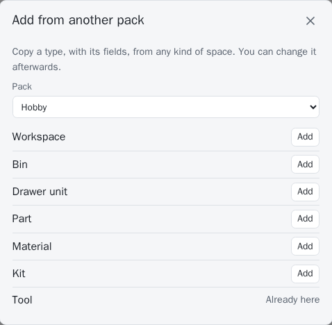

# Types and fields

This page is for anyone using Invy. It explains item types, the fields on them, and how to change them.

Every item already has a name, a marking (whatever is written on it), notes and tags. A **type** adds fields for one
kind of thing: a *Tool* might have a brand, a price and a power source, a *Box* a size. Each space has its own types.

Anyone in a space can look at its types on the **Types** tab. Editors and owners can change them.

## Add or change a type

1. Open the **Types** tab and press **New type**, or **Edit** on a type.
2. Give it a **Name** and, if you like, a **Colour**.
3. Turn on **Holds items** for places and containers, such as a room, a shelf or a box. Other items can then go
   inside items of this type.
4. Press **Add a field** for each field, and fill in:
    - **Field name**: what people see, such as *Best before*.
    - **Search name**: the name used in search, such as `best_before`. Invy suggests one from the field name. It
      starts with a letter and uses lowercase letters, numbers and underscores.
    - **Kind**: what the field holds (see below).
    - **Unit** or **Currency** for a number or money, such as *kg* or *USD*.
    - **Choices, one per line** for a choice field.
    - **Ask for it**: shown as needed when filling in an item. It never stops an item being saved.
    - **Sort and compare**: lets you sort by the field and search ranges such as `price>50`.
    - **Remind, days ahead** and **Repeats every, months** for a date, while the space has Reminders on: see
      [Reminders and upkeep](reminders.md).
   With an AI model set up, **Suggest fields** asks it which fields suit the type's name, such as *Set number*,
   *Theme* and *Pieces* for *Lego sets*. Tick the ones you want and press **Add the ticked fields**, then change them
   like any other field. Nothing is saved until you press **Save**.
5. Use the arrows to change the order of fields, and the bin to remove one.
6. Press **Save**.

## Add a type from another pack

Each [kind of space](spaces.md#kinds-of-space) starts with its own types, but any space can borrow one: a home might
want the *Collectible* type from the collection pack.

1. Open the **Types** tab and press **Add from another pack**.
2. Pick a **Pack**: **Home**, **Hobby**, **Collection** or **Business**.
3. Press **Add** beside the type you want. A type the space already has a type of the same name for shows
   **Already here**.

The type comes with its fields, and you can change it like any other.

## Kinds of field

| Kind | Holds |
|---|---|
| Text | one line, such as a brand |
| Long text | several lines |
| Number | a number, with an optional unit |
| Money | an amount, with an optional currency |
| Date | a day |
| Yes or no | a tick |
| One choice | one of the field's choices |
| Several choices | any of the field's choices |
| Web address | a link, such as a manual |
| Barcode | a barcode number, such as an ISBN |
| Person | a person's name |
| Another item | another item in the same space |

Long text, several choices and another item can't be sorted on.

## What changing a type does to items

Changing a type never changes items. Renaming a field keeps every value, because items store values by the field,
not by its name. If you remove a field, items keep its value and show it under **Other fields**. Removing a whole
type keeps its items and their values too.

Some words are already used by search and can't be a field's search name: `type`, `in`, `is`, `has`, `tag`, `seen`,
`added`, `qty`, `name`, `notes`, `marking`, `code` and `status`.

## If something goes wrong

- *"Someone else changed … while you were editing it."* Two people saved the same type. Close the editor, open the
  type again to see their change, and make yours again.
- *"There is already a type called …"* Type names are unique in a space, ignoring capitals. Pick another name.
- *"You can only look in …"* You're a viewer in this space. Ask an owner to make you an editor.
